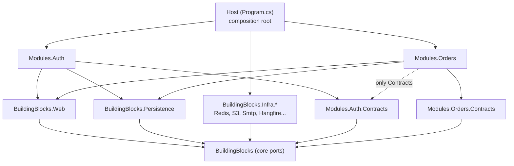

# Onboarding: .NET for NestJS developers

> A guided tour of this repository for someone who knows NestJS and TypeScript well, and .NET only from the `PaymentProcessor` console app. Every section maps a .NET idea to the NestJS idea you already know, then points at the real file to open.

Throughout this doc, the "Nest repo" means `cxcadvantage_engagement_ms` (NestJS 11, TypeORM, BullMQ, vitest). "This repo" means `Acme.Service`, the .NET 10 modular-monolith template you are standing in.

## Contents

1. [The 10-minute mental model](#1-the-10-minute-mental-model)
2. [What you already know, and what is new](#2-what-you-already-know-and-what-is-new)
3. [Tooling: npm world to dotnet world](#3-tooling-npm-world-to-dotnet-world)
4. [Repo tour](#4-repo-tour)
5. [The architecture in one page](#5-the-architecture-in-one-page)
6. [Concept-by-concept mapping](#6-concept-by-concept-mapping)
7. [Worked example: tracing `POST /api/v1/orders`](#7-worked-example-tracing-post-apiv1orders)
8. [Getting it running](#8-getting-it-running)
9. [Recipes](#9-recipes)
10. [Rules that will bite you](#10-rules-that-will-bite-you)
11. [Learning path from PaymentProcessor](#11-learning-path-from-paymentprocessor)
12. [Glossary](#12-glossary)
13. [Command cheat-sheet](#13-command-cheat-sheet)
14. [Known rough edges](#14-known-rough-edges)

---

## 1. The 10-minute mental model

If you remember nothing else, remember this table.

| NestJS (Nest repo) | This repo (.NET) | Where to look |
| --- | --- | --- |
| `main.ts` + `AppModule` | `Program.cs` (the "composition root") | `src/Host/Acme.Service.Host/Program.cs` |
| `@Module({...})` class | A class implementing `IModule` | `src/Modules/Orders/Acme.Service.Modules.Orders/OrdersModule.cs` |
| `@Controller` + `@Post()` method | A class implementing `IEndpoint` with `MapPost(...)` (ASP.NET *minimal API*) | `Features/CreateOrder/CreateOrderEndpoint.cs` |
| DTO with `class-validator` decorators | A `record` plus a FluentValidation `AbstractValidator<T>` | `Features/CreateOrder/CreateOrderCommand.cs`, `CreateOrderValidator.cs` |
| Service method / `*.uc.ts` use case | A class implementing `IUseCase<TIn, TOut>` | `Features/CreateOrder/CreateOrderUseCase.cs` |
| The Nest `Broker.runUsecases` transaction wrapper | `UseCasePipeline` running Logging → Validation → Transaction behaviors | `src/BuildingBlocks/Acme.Service.BuildingBlocks/UseCases/` |
| Throwing `NotFoundException` | Returning `Result.Failure(Error)`; HTTP mapping happens at the edge | `src/BuildingBlocks/Acme.Service.BuildingBlocks/Results/` |
| `ResponseInterceptor` envelope | RFC 7807 *ProblemDetails* (no envelope, ADR-0011) | `docs/adr/` |
| Guards (`AuthorizationGuard`, `RolesGuard`) | ASP.NET authentication + authorization middleware, `RequirePermission(...)` | `Program.cs`, `BuildingBlocks.Web/Authorization/` |
| Interceptors / Pipes / Filters | Middleware (HTTP level) + use-case behaviors (application level) | `Program.cs`, `UseCases/Behaviors/` |
| `ConfigModule` + `.env` + Joi | `appsettings*.json` + user-secrets + env vars + validated *options* | `src/Host/Acme.Service.Host/appsettings.json` |
| TypeORM entity + `@Column` | Plain class + an `IEntityTypeConfiguration<T>` (EF Core, Fluent API) | `Persistence/Configurations/OrderConfiguration.cs` |
| `BaseRepository` / `BaseService` | `IRepository<T,Id>` / `EfRepository` + `IUnitOfWork` | `BuildingBlocks.Persistence/EfRepository.cs` |
| TypeORM migrations (`npm run migration:run`, run at container start) | EF migrations, applied by a separate `migrate` command/Job, never by the web app | `docs/operations/migrations.md` |
| BullMQ `JobQueueAdapter` | `IJobQueue` port; Hangfire or in-memory implementation | `BuildingBlocks/Infra/` |
| `outboxEvent` / `inboxEvent` modules | Built-in outbox/inbox in every module's schema | `BuildingBlocks.Persistence/Outbox`, `.../Inbox` |
| vitest + supertest | xUnit v3 + Shouldly + `WebApplicationFactory` + Testcontainers | `tests/` |
| `nest-cli`, `package.json` scripts | `dotnet` CLI, `.csproj`, `Directory.Build.props`, `scripts/` | repo root |

Three differences matter more than any single mapping:

1. **No decorators and no reflection-driven wiring.** Nest discovers things through metadata (`@Controller`, `@Injectable`). Here, wiring is explicit method calls on a service collection, plus *assembly scanning* for interfaces such as `IEndpoint`.
2. **Compile-time strictness is a feature.** Warnings are errors, style violations break the build, and architecture rules are unit tests. You will be told "no" by the compiler far more often than in TypeScript.
3. **Boundaries are physical.** A Nest module boundary is a convention. Here a module is a separate *assembly* (a `.csproj`); its types are `internal` by default, so other modules *cannot compile* against them.

---

## 2. What you already know, and what is new

`PaymentProcessor` already used: classes, interfaces, records, enums, nullable reference types, LINQ, `async`/`await`, primary constructors, collection expressions, manual constructor injection, and `System.Text.Json`. This doc skips all of that.

What this repo adds on top (and what the rest of this doc explains):

| New concept | Why it matters here | Section |
| --- | --- | --- |
| The DI container (`IServiceCollection`) | Replaces your hand-written `new PaymentService(new TransactionService())` | [6.1](#61-startup-and-the-di-container) |
| `Host` / `WebApplication` builder and configuration | Replaces `Program.cs` top-level statements that ran once and exited | [6.1](#61-startup-and-the-di-container), [6.6](#66-configuration) |
| ASP.NET Core request pipeline and minimal APIs | Your first HTTP server | [6.3](#63-the-request-pipeline-middleware-guards-interceptors) |
| EF Core | Replaces your in-memory `List<T>` fields | [6.7](#67-persistence-ef-core-vs-typeorm) |
| Solution, many projects, NuGet, lock files | The repo has 22 projects | [3](#3-tooling-npm-world-to-dotnet-world), [4](#4-repo-tour) |
| Cancellation tokens | Every I/O method takes one | [12](#12-glossary) |

---

## 3. Tooling: npm world to dotnet world

### 3.1 Files and what they are

| Node / Nest | .NET | In this repo |
| --- | --- | --- |
| `package.json` (per app) | `*.csproj` (per project) | One per project, e.g. `src/Host/Acme.Service.Host/Acme.Service.Host.csproj` |
| Monorepo workspace root (`pnpm-workspace.yaml`, nx) | Solution file | `Acme.Service.slnx` (the new XML solution format) |
| Dependency versions scattered in each `package.json` | **Central Package Management** | `Directory.Packages.props` holds every version; a `PackageReference` has no `Version` attribute |
| `package-lock.json` | `packages.lock.json` per project | Committed. CI restores with `--locked-mode` and fails on a stale lock |
| `tsconfig.json` (strict, target) | `Directory.Build.props` | `net10.0`, nullable on, `TreatWarningsAsErrors=true`, analyzers |
| `.nvmrc` / `engines` | `global.json` | Pins the SDK version (10.0.401, `rollForward: latestFeature`) |
| eslint + prettier + lint-staged | `.editorconfig` + analyzers + `dotnet format` | Enforced *in the build* (`EnforceCodeStyleInBuild`) and in CI |
| `npm install -g @nestjs/cli` | `dotnet tool` (local tool manifest) | `.config/dotnet-tools.json` pins `dotnet-ef` |
| Path aliases (`@modules/*`) | **Project references** | `<ProjectReference Include="..."/>` in a `.csproj` |
| `dist/` | `bin/` and `obj/` | Gitignored |
| `npm run <script>` | `dotnet <verb>` plus `scripts/` | See the [cheat-sheet](#13-command-cheat-sheet) |

### 3.2 Project, assembly, namespace

- A **project** (`.csproj`) compiles to an **assembly** (`.dll`). Think "one npm package". Project A can only use project B's code if A has a `ProjectReference` to B *and* the type is `public`.
- A **namespace** is just a naming prefix (like a folder path in import specifiers). Namespaces here mirror folders: `Acme.Service.Modules.Orders.Features.CreateOrder`.
- **`internal`** means "visible inside this assembly only". It is this repo's most important keyword: almost everything in a module is `internal`. Only the `*Module` class (and the `*.Contracts` project) is `public`.

### 3.3 Why `packages.lock.json` appears in `git status`

Every project has one, and they are committed. After you add or upgrade a package run:

```bash
dotnet restore Acme.Service.slnx --force-evaluate
```

then commit the changed lock files. Forgetting this is the #1 cause of "works locally, red in CI".

### 3.4 Warnings are errors

`Directory.Build.props` sets `TreatWarningsAsErrors=true`, and `.editorconfig` raises style rules (file-scoped namespaces, `using` outside the namespace, braces required, explicit accessibility) to warnings. A missing brace *fails the build*. Run `dotnet format Acme.Service.slnx` before pushing; CI runs `dotnet format --verify-no-changes`.

---

## 4. Repo tour

```text
csharpBoilerplate/
├── Acme.Service.slnx            # the "workspace": lists every project
├── Directory.Build.props        # settings applied to every project (like a shared tsconfig)
├── Directory.Packages.props     # every NuGet version, in one place
├── global.json                  # pinned SDK version
├── nuget.config                 # package source (nuget.org only)
├── .editorconfig                # code style, enforced at build time
├── Dockerfile                   # 3-stage: restore-cache layer, publish, chiseled runtime image
├── src/
│   ├── Host/Acme.Service.Host/              # the ONLY deployable; Program.cs lives here
│   ├── BuildingBlocks/
│   │   ├── Acme.Service.BuildingBlocks/             # core ports: Result, UseCases, ICache, IBlobStore, ...
│   │   ├── Acme.Service.BuildingBlocks.Web/         # ASP.NET glue: IModule, IEndpoint, ProblemDetails, authz
│   │   ├── Acme.Service.BuildingBlocks.Persistence/ # EF Core base, outbox/inbox, locks, migration runner
│   │   └── Infra/                                   # one project per provider
│   │       ├── Acme.Service.BuildingBlocks.Infra.InMemory/
│   │       ├── Acme.Service.BuildingBlocks.Infra.Redis/
│   │       ├── Acme.Service.BuildingBlocks.Infra.S3/
│   │       ├── Acme.Service.BuildingBlocks.Infra.AzureBlob/
│   │       ├── Acme.Service.BuildingBlocks.Infra.Smtp/
│   │       └── Acme.Service.BuildingBlocks.Infra.Hangfire/
│   └── Modules/
│       ├── Auth/     # Acme.Service.Modules.Auth + .Contracts (identity, JWT, MFA, RBAC)
│       └── Orders/   # Acme.Service.Modules.Orders + .Contracts (removable sample module)
├── tests/            # unit, integration, architecture tests + shared fixtures
├── deploy/
│   └── compose/      # docker compose stack for local/full-stack runs
├── docs/             # architecture, ADRs (decisions), guides, operations, cookbook
├── scripts/          # init.cs, dev-env.cs (C# file-based apps) and ci/*.sh
└── .github/          # CI workflow, dependabot, PR template
```

### 4.1 What each top-level folder is

| Folder | NestJS analogy | Notes |
| --- | --- | --- |
| `src/Host` | `main.ts` + `app.module.ts` + `configs/` | The only project with the web SDK. It references everything and composes it. Contains the `migrate` and `auth:grant-role` commands. |
| `src/BuildingBlocks` | `src/shared/` + `src/adapters/` + `src/broker/` | Reusable, business-free infrastructure. Never depends on a module. |
| `src/BuildingBlocks/Infra/*` | `src/adapters/{jobQueue,cache,blobStorage,notification}` | One project per provider, so a Redis dependency can't leak into code that doesn't use Redis. |
| `src/Modules/*` | `src/modules/*` | Business features. Each has its own DB schema, DbContext, outbox/inbox tables. |
| `*.Contracts` | (no equivalent; closest is a shared `types` package) | The *only* surface other modules may reference: integration events, permission names, small interfaces like `IUserDirectory`. |
| `tests/` | `test/` + co-located `*.spec.ts` | Separate projects, never co-located with code. |
| `deploy/` | `Dockerfile` + `.azuredevops/manifests/` | Compose for local; the image is published to GHCR by CI. |
| `docs/` | `README.md` | Unusually thorough. Start with `docs/README.md`. |
| `scripts/` | `package.json` scripts | `.cs` files run with `dotnet run scripts/x.cs`. |

### 4.2 Folders you can ignore

`.claude/`, `.agents/` and `.codex/` are AI-assistant scaffolding (agent prompts, skills, a build-plan ledger). They are not application code, are excluded from the Docker image, and `scripts/init.cs` deletes parts of them when you stamp out a new service. Ignore them unless you use those tools.

### 4.3 Anatomy of a module

Open `src/Modules/Orders/Acme.Service.Modules.Orders/`:

```text
OrdersModule.cs              # the only public type: registers services, persistence
OrdersModuleKey.cs           # const "orders" = module name = DB schema = DI key
Features/                    # one folder per use case ("vertical slices")
│   CreateOrder/
│   │   CreateOrderCommand.cs    # input record (+ the HTTP request body record)
│   │   CreateOrderValidator.cs  # FluentValidation rules
│   │   CreateOrderUseCase.cs    # the logic
│   │   CreateOrderEndpoint.cs   # the HTTP route
│   GetOrder/, ListOrders/, ...
│   Shared/                      # errors, response mappers used by several features
Domain/                      # entities (Order, OrderLine), IOrderRepository port
Persistence/                 # OrdersDbContext, Configurations/, Repositories/, Migrations/
IntegrationEventHandlers/    # consumers of events from other modules (or itself)
Jobs/                        # background/recurring jobs
Options/                     # strongly typed config for this module
```

Compare with the Nest repo: `modules/<feature>/{controllers,dtos,services,usecases,jobs,consumers}` plus entities in `core/` and repositories in `adapters/repositories/`. Here the feature's controller, DTO, validator and use case sit *together in one folder per operation*, and persistence stays inside the module.

---

## 5. The architecture in one page

**A modular monolith.** One process, one Docker image, many modules. Each module owns its own PostgreSQL *schema* (`auth.*`, `orders.*`) and never reads another module's tables. If you've ever split a NestJS app into microservices later, this is the "do the boundaries now, deploy later" version.



The rules (each one is an automated test in `tests/Acme.Service.ArchitectureTests/`):

- Host depends on everything; **only the Host may reference `Infra.*`** (R10).
- A module may depend on BuildingBlocks and on *other modules' Contracts*, never on another module's implementation (R1).
- Provider SDKs (AWS, Redis, MailKit...) appear only in `Infra.*` (R3).
- EF Core types appear only in `*.Persistence*` namespaces (R4).
- A module's only public type is its `*Module` class (R5).
- No MediatR, AutoMapper, FluentAssertions, Moq, or MassTransit v9+ (R9).

**Cross-module communication** happens only through (a) a small interface in `*.Contracts` (for example `IUserDirectory`) or (b) **integration events** via the transactional outbox. Never through HTTP calls between modules, shared tables or shared transactions.

For the long form read `docs/architecture/overview.md`, `docs/architecture/module-boundaries.md` and `docs/architecture/request-lifecycle.md`. The numbered decisions (ADRs) are in `docs/adr/`.

---

## 6. Concept-by-concept mapping

### 6.1 Startup and the DI container

**Nest repo** (`src/main.ts`): create the app, attach global pipes/guards/interceptors, listen.
`AppModule` imports feature modules; Nest's reflection-based injector builds the graph.

**This repo** (`src/Host/Acme.Service.Host/Program.cs`): there are no modules-of-modules and no decorators. `Program.cs` is a plain script in two halves:

```csharp
var builder = WebApplication.CreateBuilder(args);   // ~ NestFactory.create()

// Phase 1: REGISTER services into the container (~ the `providers:` arrays)
builder.AddObservability();
builder.Services.AddProblemDetailsSetup();
builder.AddProviders(p => { p.Add<RedisCacheRegistration>(); /* ... */ });
builder.AddModules(HostModules.Create());           // ~ imports: [AuthModule, OrdersModule]

var app = builder.Build();                          // the container is now frozen

// Phase 2: build the request PIPELINE, in order (~ app.use(...), global guards/interceptors)
app.UseCorrelationId();
app.UseAuthentication();
app.UseAuthorization();
app.MapModuleEndpoints();                           // ~ controllers' routes

await app.RunAsync();                               // ~ app.listen()
```

Key ideas:

- **`IServiceCollection` is the module system's backing store.** `AddSingleton`, `AddScoped`, `AddTransient` register a service. The container builds the graph by looking at *constructor parameters* (no `@Inject`).
- **Lifetimes** (Nest: default singleton, `Scope.REQUEST`, `Scope.TRANSIENT`):

| .NET | Meaning | Nest equivalent |
| --- | --- | --- |
| `Singleton` | one per process | default provider |
| `Scoped` | one per HTTP request (or per explicit scope) | `Scope.REQUEST` |
| `Transient` | new each time it is resolved | `Scope.TRANSIENT` |

- **Keyed services**: `[FromKeyedServices("orders")] IUnitOfWork uow` asks for "the unit of work registered under the key `orders`". This repo uses it so each module gets *its own* unit of work and outbox. Nest would use a custom provider token.
- **Verb dispatch**: the first lines of `Program.cs` switch on `args[0]`. `migrate` and `auth:grant-role` run as one-shot commands using the same image and DI wiring; anything else starts the web server. Nest equivalent: a separate `typeorm` CLI script plus a standalone `NestFactory.createApplicationContext`.
- **`public partial class Program;`** at the bottom exists so test projects can boot the real app with `WebApplicationFactory<Program>` (your `Test.createTestingModule({ imports: [AppModule] })`).

*Build on PaymentProcessor:* you wrote `new PaymentService(new TransactionService())` by hand in `Program.cs`. The container does exactly that for you, driven by constructor signatures, and manages lifetimes.

### 6.2 Modules and endpoints

**`IModule`** (`src/BuildingBlocks/Acme.Service.BuildingBlocks.Web/Modules/IModule.cs`) is `@Module`:

```csharp
public sealed class OrdersModule : IModule
{
    public string Name => OrdersModuleKey.Value;               // "orders": also the DB schema
    public IReadOnlyList<PermissionDefinition> Permissions => OrdersPermissions.Definitions;
    public void AddServices(IServiceCollection s, IConfiguration c, IHostEnvironment e) { /* providers */ }
    public void AddPersistence(IServiceCollection s, IConfiguration c) { /* DbContext */ }
    public void MapEndpoints(IEndpointRouteBuilder endpoints) { /* extras only */ }
}
```

The Host lists modules in `src/Host/Acme.Service.Host/Modules/HostModules.cs` (Auth first, then the rest). `AddModules` registers each module's services, discovers its use cases and validators by scanning the assembly, and registers its persistence.

**`IEndpoint`** replaces `@Controller`. One class per route; `AddModules`/`MapModuleEndpoints` find every `IEndpoint` in the module assembly:

| Nest controller | Minimal-API endpoint |
| --- | --- |
| `@Controller('orders') @Post() create(@Body() dto)` | `endpoints.MapPost("/api/v1/orders", (CreateOrderRequest body, ...) => ...)` |
| `@UseGuards(RolesGuard) @Roles(...)` | `.RequirePermission(OrdersPermissions.Create)` |
| `@ApiResponse(201)` (swagger) | `.Produces<OrderResponse>(201).ProducesProblem(409)` |
| `@Body()` parsed and validated by `ValidationPipe` | Parameter binding deserializes JSON to the record; validation runs later in the use-case pipeline |

Note the handler is a lambda; its parameters (`CreateOrderRequest body`, `HttpContext context`, `IUseCaseExecutor<...> executor`) are filled in by ASP.NET: the body from JSON, the rest from DI. That is "parameter injection", the minimal-API analogue of `@Body()`/`@Req()`/constructor injection together.

### 6.3 The request pipeline: middleware, guards, interceptors

Nest's order: middleware → guards → interceptors (before) → pipes → handler → interceptors (after) → filters.

ASP.NET has **middleware only**, in the exact order you register it. This repo's order (`Program.cs`, `RunWebAsync`):

| # | Middleware | Why here | Nest analogue |
| --- | --- | --- | --- |
| 1 | `UseForwardedHeadersSetup` | real client IP and scheme behind a proxy | `trust proxy` |
| 2 | `UseCorrelationId` | `X-Correlation-Id` in/out, even on 401 | `CorrelationIdMiddleware` |
| 3 | `UseRequestLogging` | Serilog request log | `pino-http` |
| 4 | `UseProblemDetailsSetup` | turns exceptions and bare 4xx into RFC 7807 bodies | `ExceptionFilter` (your Nest repo has none; `ResponseInterceptor` does this job) |
| 5 | `UseRouting` | picks the endpoint | router |
| 6 | `UseRateLimiter` | per-IP policies from endpoints | `@nestjs/throttler` |
| 7 | `UseAuthentication` | validates the JWT, builds `HttpContext.User` | `AuthGuard` (jwt) |
| 8 | `UseAuthorization` | evaluates policies, including permissions | `RolesGuard` |

**Fail closed.** JwtBearer is the default scheme and a `FallbackPolicy` demands an authenticated user. Every endpoint, *and every unknown URL*, returns 401 unless explicitly `.AllowAnonymous()` **and** listed in `tests/Acme.Service.IntegrationTests/Security/AnonymousEndpointAllowlist.cs`. In your Nest repo the global `AuthorizationGuard` checks a service key; here the model is a real JWT bearer.

**Application-level cross-cutting (interceptor-like)** is a different mechanism: *use-case behaviors* (section 6.4). Request/response shaping lives in `ProblemDetails` and `ToHttpResult()`.

### 6.4 Use cases, commands, queries, validation

This is the closest match to your Nest repo's `Broker` + `*.uc.ts` design, and the part most worth understanding.

| Concept | Nest repo | This repo |
| --- | --- | --- |
| Input shape | DTO class + `class-validator` | `record` implementing `ICommand<TOut>` (writes) or `IQuery<TOut>` (reads) |
| Logic | `Usecase.execute(context, input)` | `IUseCase<TIn,TOut>.ExecuteAsync(input, cancellationToken)` |
| "Needs a transaction" | `config = { requiresTransaction: true }` | the type is an `ICommand` (queries are never transactional) |
| Orchestrator | `Broker.runUsecases([uc], input)` | `IUseCaseExecutor<TIn,TOut>.ExecuteAsync(...)` (the `UseCasePipeline`) |
| Pre/post hooks | `beforeExecute`, `afterCommit` | Behaviors: `LoggingBehavior` → `ValidationBehavior` → `TransactionBehavior` |
| Validation | global `ValidationPipe` | `ValidationBehavior` runs every FluentValidation `AbstractValidator<T>` for the input |

Files: `src/BuildingBlocks/Acme.Service.BuildingBlocks/UseCases/` (`IUseCase.cs`, `ICommand.cs`, `IQuery.cs`, `UseCasePipeline.cs`, `Behaviors/`).

Why not MediatR? ADR-0002 decided a ~100-line in-house pipeline beats a dependency whose license changed. Architecture rule R9 fails the build if someone adds it.

Failures are **values, not exceptions**: `Task<Result<TOut>>`. A use case returns `Result.Failure(new Error("order_not_found", "...", ErrorType.NotFound))`; the endpoint's `result.ToHttpResult(...)` maps `ErrorType` to a status code. Unexpected exceptions bubble to the ProblemDetails middleware and become 500 `internal_error`. Your Nest repo throws `NotFoundException`/`ConflictException` and wraps responses in an interceptor; here you *return* the expected failure.

| `ErrorType` | HTTP |
| --- | --- |
| `Validation` | 400 |
| `Unauthorized` | 401 |
| `Forbidden` | 403 |
| `NotFound` | 404 |
| `Conflict` | 409 |
| `Unprocessable` | 422 |
| `TooManyRequests` | 429 |
| `Unavailable` | 503 (with `Retry-After`) |

(Exact mapping lives in `src/BuildingBlocks/Acme.Service.BuildingBlocks.Web/Results/`.) See `docs/architecture/error-model.md`.

### 6.5 DTOs, records and mapping

- A **`record`** is an immutable data class with value equality: the natural DTO. `internal sealed record CreateOrderRequest(string? Currency, IReadOnlyList<OrderLineRequest>? Lines);` is a whole DTO in one line.
- The HTTP body record (`CreateOrderRequest`) and the use-case input (`CreateOrderCommand`) are separate: the command adds server-derived data such as `CustomerId` taken from the JWT `sub`, never from the body.
- Entities never leave the module. Responses are built by explicit mappers (`OrderResponse.From(order)`). There is no AutoMapper (banned by R9); you map by hand, like writing a `toDto()` method.

### 6.6 Configuration

| | Nest repo | This repo |
| --- | --- | --- |
| Source files | `.local.env`, `.env` | `appsettings.json`, `appsettings.{Environment}.json` |
| Secrets (local) | `.env` (gitignored) | `dotnet user-secrets` (Development only) |
| Secrets (deployed) | Dockerfile `ARG`/`ENV` | environment variables, set as Render environment variables (never baked in the image) |
| Nesting | `registerAs('typeorm', ...)`, read `get('common.auth.jwtSecret')` | JSON sections, read as `Auth:Jwt:Issuer` |
| Env var syntax | `AUTH_JWT_ISSUER` | `Auth__Jwt__Issuer` (double underscore replaces `:`) |
| Validation | Joi schema, fail-fast | options validation at startup, exit code 1 with the failing key |

Precedence, later wins: `appsettings.json` → `appsettings.{Env}.json` → user-secrets → environment variables → command-line args.

Selecting an environment:

- `ASPNETCORE_ENVIRONMENT` (Nest: `NODE_ENV`) for the web app; the launch profile sets it to `Development`.
- **Gotcha:** the one-shot verbs (`migrate`, `auth:grant-role`) build a *plain* host that reads `DOTNET_ENVIRONMENT` instead. Without it they run as Production and miss `appsettings.Development.json` and your user-secrets. Always prefix: `DOTNET_ENVIRONMENT=Development dotnet run ... -- migrate`.

Required config and every key are documented in `docs/guides/configuration.md`; a CI script checks that every key appears there. **Never put secrets in `appsettings*.json`.**

#### The provider model

`<Category>:Provider` selects one implementation per infrastructure category, e.g. `Cache:Provider=Redis`, `Blob:Provider=S3`, `Jobs:Provider=Hangfire`. All implementations are registered in `Program.cs` (`p.Add<RedisCacheRegistration>()`), but only the selected one is activated. Invalid or missing selections stop startup with exit 1. Dev-only providers (in-memory jobs, local-disk blobs, console email) refuse to run in Production.

| Port (in core) | Providers |
| --- | --- |
| `ICache` | InMemory, Redis |
| `IBlobStore` | Local disk, S3 (works with R2/MinIO/RustFS), Azure Blob |
| `INotificationSender` | Console, SMTP (MailKit) |
| `IJobQueue` | InMemory, Hangfire (on Postgres) |
| `IDistributedLock` | InMemory, Postgres advisory locks |

Nest analogue: your `adapters/` folder (`jobQueue`, `cache`, `blobStorage`, `notification`) but chosen by config rather than by which module you import. To add one, see `docs/guides/adding-a-provider.md`.

### 6.7 Persistence: EF Core vs TypeORM

| | TypeORM (Nest repo) | EF Core (this repo) |
| --- | --- | --- |
| Mapping style | decorators on the entity (`@Column`) | entities stay plain; mapping lives in an `IEntityTypeConfiguration<T>` class (Fluent API) |
| Connection object | `DataSource` / `EntityManager` | `DbContext` (one per module: `OrdersDbContext`) |
| Table collections | `Repository<T>` | `DbSet<T>` properties on the context |
| Repository | `BaseRepository<T> extends Repository<T>` | `IRepository<T,Id>` port + `EfRepository` (`BuildingBlocks.Persistence/EfRepository.cs`) |
| Transaction | pass `EntityManager` through every call | `IUnitOfWork` (keyed per module) + `TransactionBehavior` around commands |
| Naming | `SnakeNamingStrategy` | `EFCore.NamingConventions` (snake_case) |
| Soft delete | `deletedAt` column, manual | `HasQueryFilter(o => o.DeletedAt == null)` global filter |
| Optimistic lock | `@VersionColumn` | `Version` property mapped to Postgres `xmin` (`IsRowVersion()`) |
| Schema | `app` in prod only | **one schema per module**, always, from `ModuleDbContext.Schema` |

Concepts to learn:

- **Change tracking.** `await orders.AddAsync(order)` only *tracks* the entity. Nothing hits the database until `unitOfWork.SaveChangesAsync(ct)`. (Equivalent to staging work in an `EntityManager` and committing at transaction end.) Inside commands, `TransactionBehavior` opens the transaction for you; the use case calls `SaveChangesAsync` once.
- **Tracking vs no-tracking.** The repository's `GetForReadAsync`/`ListForReadAsync` return *untracked snapshots* for queries; inherited `GetAsync` returns tracked entities for commands.
- **`IEnumerable` vs `IQueryable`.** `IQueryable` builds SQL; calling `.ToList()` runs it. If you apply `.Where(...)` *after* materializing, you filter in memory. This repo hides most of it behind `Specification<T>`, but know the trap.
- **Value ownership.** `OwnsMany(o => o.Lines, ...)` stores `OrderLine` in its own table as part of the `Order` aggregate (like an `@OneToMany` with `cascade: true` that cannot exist alone).
- **Two connection strings.** `ConnectionStrings:Postgres` is the app role (DML only); `ConnectionStrings:PostgresMigrations` is the DDL role used by `migrate` and `dotnet ef`. The web app cannot alter schema.

Constants: `src/BuildingBlocks/Acme.Service.BuildingBlocks.Persistence/ConnectionStringNames.cs`. Transient DB faults map to 503 `database_unavailable`; unique violations and concurrency conflicts map to 409 (`DatabaseErrors.cs`).

#### Migrations

| | Nest repo | This repo |
| --- | --- | --- |
| Create | `npm run migration:generate` | `dotnet ef migrations add <Name> ...` (see [recipe](#94-add-a-migration)) |
| Run | `npm run migration:run:prod && node dist/main` (every container start) | `... -- migrate` verb, a separate compose service or one-shot container; **the web host never migrates**; opt-in `Migrations__RunOnStart=true` runs the same `migrate` step before the app starts (ADR-0009) |
| If pending | app starts anyway | `/health/ready` returns 503 until migrated |
| Concurrency | n/a | `migrate` takes a Postgres advisory lock so two Jobs can't collide |

### 6.8 Messaging: outbox, inbox, jobs

Both repos use the transactional outbox/inbox. The difference is who provides it.

| | Nest repo | This repo |
| --- | --- | --- |
| Outbox | `outboxEvent` module + `OutboxEventService.saveEvent(data, entityManager)` | every module schema has `outbox_messages`; `IOutbox.Enqueue(event)` in the same transaction |
| Dispatcher | custom cron/consumers | `OutboxDispatcher` hosted background service |
| Inbox | `InboxEvent` + cleanup cron | `inbox_messages` + `InboxHandlerDecorator` for idempotent consumers |
| Queue | BullMQ on Redis | `IJobQueue` port (Hangfire on Postgres, or in-memory in dev) |
| Event contract | ad hoc types | `[IntegrationEvent("orders.order-placed.v1")]` records in a `*.Contracts` project, with a persisted-name registry |

Flow of `OrderPlacedV1` (see `CreateOrderUseCase.cs` and `OrdersModule.cs`): the use case enqueues the event inside the order's transaction → `OutboxDispatcher` publishes it → `OrderPlacedHandler` (an inbox consumer) receives it exactly-once-effectively → it enqueues `SendOrderPlacedNotificationJob` → that job asks Auth for the user's email through `IUserDirectory` (from `Auth.Contracts`) and sends mail via `INotificationSender`. Docs: `docs/architecture/messaging.md`, `docs/guides/integration-events.md`, `docs/guides/background-jobs.md`.

### 6.9 Authentication and authorization

| | Nest repo | This repo |
| --- | --- | --- |
| Model | gateway trust: service-key header + `x-user-profile` JSON | real JWT (RS256), refresh-token rotation with reuse detection, optional MFA (TOTP) and OIDC |
| Global check | `AuthorizationGuard` | `FallbackPolicy` (everything requires auth) |
| Per-route role | `@Roles(...)` + `RolesGuard` | `.RequirePermission("orders.create")` |
| Where permissions live | role enum | *permissions* are declared by each module (`IModule.Permissions`) and carried in the token |

Open `src/Modules/Auth/` and `docs/guides/auth.md` and `docs/guides/permissions.md`. There is no default admin; after registering, run `auth:grant-role --email ... --role Admin`.

### 6.10 Observability and health

| | Nest repo | This repo |
| --- | --- | --- |
| Logs | `nestjs-pino` | Serilog (`Serilog.AspNetCore`), with OTLP sink |
| Tracing/metrics | APM module | OpenTelemetry (ASP.NET, HTTP, runtime, custom outbox metrics) |
| Correlation id | `CorrelationIdMiddleware` + AsyncLocalStorage | `UseCorrelationId` + `ICorrelationContext`; propagated to outbound `HttpClient` calls |
| Health | `@nestjs/terminus`, `/health` | `/health/live` (process up), `/health/ready` (DB reachable and no pending migrations) |
| API docs | `@nestjs/swagger` at `/docs` | built-in OpenAPI at `/openapi/v1.json` + Scalar UI at `/scalar` (Development only) |

### 6.11 Testing

| | Nest repo | This repo |
| --- | --- | --- |
| Runner | vitest | xUnit v3 (run through VSTest) |
| Assertions / mocks | `expect`, `vi.fn()` | Shouldly (`x.ShouldBe(...)`), NSubstitute (`Substitute.For<T>()`) |
| Boot the app | `Test.createTestingModule({ imports: [AppModule] })` + supertest | `WebApplicationFactory<Program>` via `tests/Acme.Service.Testing/ServiceWebFactory.cs` |
| Real infra | needs a live DB/Redis | Testcontainers spin up Postgres, Redis, RustFS, Azurite, Mailpit per run |
| Spec location | `src/**/*.spec.ts` (none exist yet) | separate projects under `tests/` |
| Boundary rules | convention | NetArchTest in `tests/Acme.Service.ArchitectureTests/` |

Details to know:

- Tests needing Docker carry `[Trait("Category", "Integration")]`. Unit run: `--filter "Category!=Integration"`.
- Naming convention: `Method_Scenario_Expected`.
- Inject `TimeProvider` instead of calling `DateTime.UtcNow`; tests use a fake clock and never `Thread.Sleep`.
- **Contract test suites** (`tests/Acme.Service.Testing/Contracts/`) define one abstract suite per port (`ICache`, `IBlobStore`, ...). Each provider's test class derives from it, so Redis and InMemory are held to the same behavior.
- Integration tests get *real tokens* by registering a user, reading the confirmation link from `CapturingNotificationSender`, and logging in.
- Test projects cannot reference each other. `Acme.Service.Testing` is a shared library, not a test project.

Guide: `docs/guides/testing.md`.

---

## 7. Worked example: tracing `POST /api/v1/orders`

Nest repo's "create country": controller → global pipes/guards → `Broker.runUsecases` → usecase → service → repository → entity manager.

This repo's "create order", file by file under `src/Modules/Orders/Acme.Service.Modules.Orders/`:

```text
HTTP POST /api/v1/orders  (Authorization: Bearer <jwt>, Idempotency-Key: <opt>)
  │
  ├─ middleware: forwarded headers → correlation id → request log → problem-details
  │              → routing → rate limiter → authentication (JWT) → authorization
  │
  ├─ Features/CreateOrder/CreateOrderEndpoint.cs
  │     .RequirePermission(OrdersPermissions.Create)   # 403 if the token lacks it
  │     .WithIdempotency()                             # replays the first response for a repeated key
  │     body JSON → CreateOrderRequest record
  │     builds CreateOrderCommand(callerId from JWT `sub`, body.Currency, body.Lines)
  │     calls IUseCaseExecutor<CreateOrderCommand, OrderResponse>.ExecuteAsync(...)
  │
  ├─ UseCasePipeline (BuildingBlocks/UseCases)
  │     LoggingBehavior      → logs start/finish
  │     ValidationBehavior   → CreateOrderValidator (FluentValidation) → 400 problem on failure
  │     TransactionBehavior  → opens the module's keyed IUnitOfWork transaction (it's an ICommand)
  │
  ├─ Features/CreateOrder/CreateOrderUseCase.cs
  │     Order.Place(...)                         # domain factory enforces invariants
  │     orders.AddAsync(order)                   # IOrderRepository → tracked in OrdersDbContext
  │     outbox.Enqueue(new OrderPlacedV1(...))   # event row in orders.outbox_messages
  │     unitOfWork.SaveChangesAsync()            # ONE commit: order + lines + outbox row
  │     return OrderResponse.From(order)         # Result<OrderResponse> success
  │
  └─ endpoint: result.ToHttpResult(order => TypedResults.Created(path, order))
        → 201 + Location header, or ProblemDetails for a failure Result
```

The Nest equivalent maps stage by stage:

| Stage | Nest repo | This repo |
| --- | --- | --- |
| Route | `@Post('/')` in `CountryController` | `MapPost` in `CreateOrderEndpoint` |
| Shape | `CreateCountryDto` + `class-validator` | `CreateOrderRequest` / `CreateOrderCommand` + `CreateOrderValidator` |
| Wrapper | `Broker.runUsecases([...])` | `IUseCaseExecutor` → `UseCasePipeline` |
| Logic | `AddCountryUsecase.execute` | `CreateOrderUseCase.ExecuteAsync` |
| Persistence | `BaseService.create` → `repo.save(entity)` with passed `EntityManager` | `orders.AddAsync` + `unitOfWork.SaveChangesAsync` |
| Event | `OutboxEventService.saveEvent(data, entityManager)` | `outbox.Enqueue(event)` |
| Output | `ResponseInterceptor` wraps `{ statusCode, success, result }` | `201` body is the `OrderResponse` itself; errors are ProblemDetails |

Notice what is *absent*: no decorators, no controller class, no module `imports`/`exports`, no `@Injectable`. The use case's dependencies arrive through its **primary constructor**:

```csharp
internal sealed class CreateOrderUseCase(
    IOrderRepository orders,
    [FromKeyedServices(OrdersModuleKey.Value)] IUnitOfWork unitOfWork,
    [FromKeyedServices(OrdersModuleKey.Value)] IOutbox outbox,
    TimeProvider timeProvider) : IUseCase<CreateOrderCommand, OrderResponse>
```

Registration was automatic: `AddModules` scanned the assembly for `IUseCase<,>` and `AbstractValidator<>`.

---

## 8. Getting it running

Prerequisites: the .NET SDK version in `global.json`, and Docker. The commands below mirror `docs/guides/getting-started.md`, which is the source of truth.

Optional but handy: [Task](https://taskfile.dev/installation) (`brew install go-task`), the closest thing here to `npm run <script>`. `Taskfile.yml` at the root names every command (`task --list` shows them all; reference: `docs/guides/task-commands.md`). Each step below shows the `task` form first and the raw command after it; CI only uses the raw commands.

### 8.1 First build

```bash
task dev:setup   # tool restore, locked restore, deploy/compose/.env (8.2), PostgreSQL
task b           # Release build, warnings are errors
```

Without `task`:

```bash
dotnet tool restore                                # installs dotnet-ef from .config/dotnet-tools.json
dotnet build Acme.Service.slnx -c Release          # warnings are errors
```

### 8.2 Generate local secrets

```bash
task dev:env                    # part of task dev:setup; skipped when the file exists
dotnet run scripts/dev-env.cs   # without task
```

This writes `deploy/compose/.env` (gitignored) with a generated JWT signing key and random passwords, and prints `dotnet user-secrets set ...` commands. Treat that output as secret. It will not overwrite an existing `.env` unless you pass `-- --force`.

### 8.3 Path A: everything in Docker Compose

```bash
task up                                            # or, without task:
docker compose -f deploy/compose/compose.yaml up -d --build
curl -s -o /dev/null -w '%{http_code}\n' localhost:8080/health/ready   # expect 200
```

Starts Postgres, Redis, RustFS (S3), Azurite, Mailpit (web UI at `http://localhost:8025`), a one-shot `migrate`, and the app. The app runs as Production, so no OpenAPI/Scalar here.

### 8.4 Path B: debug the Host on your machine (recommended for development)

Only Postgres is required; everything else uses in-process providers.

```bash
task docker:up:infra   # PostgreSQL only
# run the `dotnet user-secrets set ...` lines printed by scripts/dev-env.cs
task db:migrate        # sets DOTNET_ENVIRONMENT=Development for you
task r                 # or task dev:watch for hot reload
```

Without `task`:

```bash
docker compose -f deploy/compose/compose.yaml up -d postgres
# run the `dotnet user-secrets set ...` lines printed by scripts/dev-env.cs
DOTNET_ENVIRONMENT=Development dotnet run --project src/Host/Acme.Service.Host -- migrate
dotnet run --project src/Host/Acme.Service.Host
```

- API at `http://localhost:8080`, interactive docs at `http://localhost:8080/scalar`.
- Emails are logged to the console (in Development the body includes the confirmation link).
- Re-run `migrate` after every pull that adds migrations. Until you do, `/health/ready` is 503.
- List pending migrations: `task db:migrate:list` or `... -- migrate --list`.

In an IDE (Rider, VS, VS Code C# Dev Kit), open `Acme.Service.slnx`, set `Acme.Service.Host` as the startup project, and use the `http` launch profile.

### 8.5 First authenticated call

Every route needs a token, and unknown routes return 401.

1. `POST /api/v1/auth/register` (always returns 202).
2. Take the `userId` and `token` from the verification link (Mailpit UI, or the console log), then confirm and log in.
3. Bootstrap an admin: `DOTNET_ENVIRONMENT=Development dotnet run --project src/Host/Acme.Service.Host -- auth:grant-role --email you@example.com --role Admin`, then log in again.

Full flows: `docs/guides/auth.md`.

### 8.6 Test, format, lint

```bash
task t                                             # unit + architecture, no Docker needed
task test:integration                              # needs Docker
task test:one PROJECT=tests/Acme.Service.Modules.Auth.Tests
task test:arch
task dev:format:check                              # task f fixes in place
task ci                                            # the CI build-test gates plus the doc checks
```

Without `task`:

```bash
dotnet test Acme.Service.slnx -c Release --filter "Category!=Integration"   # no Docker needed
dotnet test Acme.Service.slnx -c Release --filter "Category=Integration"    # needs Docker
dotnet test tests/Acme.Service.Modules.Orders.Tests -c Release              # one project
dotnet test Acme.Service.slnx -c Release --filter "FullyQualifiedName~ArchitectureTests"
dotnet format Acme.Service.slnx --verify-no-changes
```

Before opening a PR, make sure all of the above pass (`task ci` runs the CI gates in order), plus the CI helper scripts in `scripts/ci/` that apply to your change (for example `check-doc-links.sh` if you touched docs).

---

## 9. Recipes

Each recipe mirrors something you'd do in Nest. Detailed versions are in `docs/guides/` and `docs/cookbook.md`.

### 9.1 Add an endpoint/use case to an existing module

Nest: new DTO, new usecase class, method on controller, register in module providers.
Here, create `Features/<Name>/` with four files (copy `Features/GetOrder/` or `Features/CreateOrder/` as a template):

1. `<Name>Command.cs` or `<Name>Query.cs`: the input record.
2. `<Name>Validator.cs`: `AbstractValidator<...>` (use `RuleFor(...)`).
3. `<Name>UseCase.cs`: `IUseCase<TIn,TOut>`; return `Result<T>`.
4. `<Name>Endpoint.cs`: `IEndpoint` with `MapGet/MapPost/...`, `.RequirePermission(...)`, `.Produces...`.

No registration step: the assembly scan picks all four up. Add a test. Guide: `docs/guides/adding-a-use-case.md`.

### 9.2 Add a new module

Nest: `nest g module`, wire into `AppModule`.
Here you create two projects (`<Name>` and `<Name>.Contracts`), a `<Name>Module : IModule`, a `<Name>DbContext : ModuleDbContext` with `Schema => "<name>"`, add the projects to `Acme.Service.slnx`, reference them from the Host, and add the module in `src/Host/Acme.Service.Host/Modules/HostModules.cs`. Then the first migration. Guide: `docs/guides/adding-a-module.md`. The Orders module is the reference implementation.

### 9.3 Add a permission

Declare it in the module's `*Permissions.cs` (see `OrdersPermissions.cs`) with its seed roles; protect the endpoint with `.RequirePermission(...)`. Guide: `docs/guides/permissions.md`.

### 9.4 Add a migration

Nest: `npm run migration:generate`.
With task: `task db:add MODULE=Orders NAME=AddOrderNotes` (no database needed; then the follow-up below and `task db:migrate`).
Without task (replace the module and context names):

```bash
dotnet tool restore
export ConnectionStrings__PostgresMigrations="Host=localhost;Port=5432;Database=acme_service;Username=postgres"
dotnet ef migrations add AddOrderNotes \
  --project src/Modules/Orders/Acme.Service.Modules.Orders \
  --startup-project src/Host/Acme.Service.Host \
  --context OrdersDbContext \
  --output-dir Persistence/Migrations
```

Then: make the generated migration, designer and snapshot classes `internal` (otherwise architecture rule R5 fails), review the SQL, run `... -- migrate`, and commit. Never edit an applied migration. The connection string above is a local-dev example; use your own and keep real credentials out of the repo.

### 9.5 Add a provider

Implement the port in a new `Infra.<Name>` project, add an `IProviderRegistration`, add one line in `Program.cs` (`p.Add<...>()`), document its config keys in `docs/guides/configuration.md`. Guide: `docs/guides/adding-a-provider.md`.

### 9.6 Publish or consume an integration event

Define the record in the producing module's `*.Contracts` project with `[IntegrationEvent("module.name.v1")]`; enqueue with `IOutbox` in the same transaction; add an `IIntegrationEventHandler<T>` in the consumer and register it with `AddIntegrationEventHandler`. Never edit a published event shape: add `V2`. Guide: `docs/guides/integration-events.md`.

### 9.7 Add a configuration option

Add a strongly typed options class in the module's `Options/`, register it in the module's `AddServices` (see `OrdersOptions.Register`), add the key to `appsettings.json` with a safe default, and document it in `docs/guides/configuration.md`. A CI script fails if a key is undocumented.

### 9.8 Add a NuGet package

Add `<PackageVersion>` in `Directory.Packages.props`, add a version-less `<PackageReference>` in the project, then:

```bash
dotnet restore Acme.Service.slnx --force-evaluate
```

Commit the lock files. High/critical advisories fail the build; check the packages aren't on the banned list (R9).

---

## 10. Rules that will bite you

| Rule | Symptom | Fix |
| --- | --- | --- |
| Warnings are errors | `error CS...` / `error IDE...` for style, or nullable warnings | fix the code; run `dotnet format` |
| `internal` by default (R5) | "inaccessible due to its protection level", or an architecture test fails on a new `public` type | keep types `internal`; only `*Module` and `*.Contracts` are public |
| No cross-module references (R1) | architecture test fails after adding a `ProjectReference` | go through `*.Contracts` or an integration event |
| EF types only in `*.Persistence*` (R4) | architecture test fails | hide EF behind a repository port |
| Provider SDKs only in `Infra.*` (R3) | architecture test fails | add a port + provider |
| Banned packages (R9) | restore/arch test failure | use the in-house pipeline / hand mapping |
| Stale lock files | CI restore fails with `--locked-mode` | `dotnet restore --force-evaluate`, commit locks |
| Fail-closed auth | a new public route returns 401 | `.AllowAnonymous()` *and* add to `AnonymousEndpointAllowlist.cs` |
| Web app never migrates (`Migrations__RunOnStart` off) | `/health/ready` is 503, tables missing | run the `migrate` verb |
| `DOTNET_ENVIRONMENT` for verbs | `migrate` can't find the connection string | prefix the command with `DOTNET_ENVIRONMENT=Development` |
| Secrets | gitleaks fails CI | use user-secrets/env vars; never in `appsettings*.json` or tracked files |
| Docs conventions | doc link/config-key checks fail | every backticked path must exist; every config key documented |
| Template tokens | arch test about `Acme.Service` fails in a renamed service | after `init.cs`, only the new name may appear |
| Integration events are append-only | consumers break after a rename | never change `[IntegrationEvent("...")]` names or shapes; add a version |

Style conventions worth memorising: file-scoped namespaces, `using` outside the namespace, braces always, explicit `private`/`internal`, `var` where the type is obvious, `async` methods take a `CancellationToken` and end with `Async`, use `.ConfigureAwait(false)` in library code (as the use cases do), inject `TimeProvider` instead of reading the clock.

---

## 11. Learning path from PaymentProcessor

Rebuild your `PaymentProcessor` domain (Payment, Transaction) one layer at a time. Each step is small and maps to a part of this repo.

1. **DI and the Host.** Replace manual `new` calls with `Host.CreateApplicationBuilder(args)`; register `IPaymentService` and `ITransactionService` with `services.AddSingleton<,>()`; resolve and run. Add `ILogger<T>` instead of `Console.WriteLine`. *(Reads: section 6.1.)*
2. **Configuration and options.** Add `appsettings.json`, a `PaymentOptions` class, bind it, validate on start. Override with an env var using `__`. *(Section 6.6.)*
3. **A web API.** Switch the project to the web SDK; expose `POST /payments` with a minimal API; return `Results.Created`/`Results.Problem`. *(Sections 6.2, 6.3.)*
4. **Results instead of exceptions.** Return a `Result<T>` from the service and map to HTTP at the edge. Compare with `Result` in `BuildingBlocks/Results/`. *(Section 6.4.)*
5. **EF Core and Postgres.** Add a `DbContext`, an `IEntityTypeConfiguration<Payment>`, create and apply a migration, replace the `List<T>`. *(Section 6.7.)*
6. **Tests.** xUnit + Shouldly for services; `WebApplicationFactory<Program>` for the API (remember `public partial class Program;`). *(Section 6.11.)*
7. **Read the real thing.** Now `Features/CreateOrder/` will read like your own code. Then pick a small task: add a field to `Order` (config + migration + response + tests).

While learning, fix the rough edges noticed in `PaymentProcessor` as free practice: the constructor `id` parameter being ignored by `Id { get; } = Guid.NewGuid()`, `new DateTime()` producing year 0001, and a filter using `>=` where `<=` was intended. Each is a good first unit test.

Suggested reading order inside this repo: `docs/README.md` → `docs/architecture/overview.md` → `docs/architecture/request-lifecycle.md` → `docs/guides/getting-started.md` → `docs/guides/adding-a-use-case.md` → the ADRs when a decision puzzles you.

---

## 12. Glossary

| Term | Meaning (with Nest/JS analogy) |
| --- | --- |
| **SDK / runtime** | Build tooling vs the runtime that executes the app. Like Node + npm + tsc bundled. |
| **TFM** | Target framework moniker, e.g. `net10.0`: the platform version a project targets. |
| **csproj** | Project file (XML): references, packages, settings. Like `package.json` + `tsconfig`. |
| **slnx** | Solution file listing projects. Like a workspace manifest. |
| **NuGet** | The package registry/manager. Like npm. |
| **Assembly** | The compiled output (`.dll`) of a project. Like a built package. |
| **Namespace** | Naming prefix that groups types. Like module paths. |
| **`internal`** | Visible only inside the same assembly. Like not exporting from a package. |
| **`sealed`** | A class that cannot be inherited. Default to it. |
| **`record`** | Immutable data type with value equality. A DTO in one line. |
| **`Task` / `Task<T>`** | A promise. `await` works the same as in JS. |
| **`CancellationToken`** | A cancel signal passed down (like `AbortSignal`). ASP.NET supplies `HttpContext.RequestAborted`. |
| **`IServiceCollection` / `IServiceProvider`** | The DI registrations / the built container. |
| **Keyed service** | A service registered under a string key, resolved with `[FromKeyedServices("key")]`. |
| **Lifetime** | Singleton, Scoped (per request), Transient. |
| **Middleware** | A function in the request pipeline, run in registration order. |
| **Minimal API** | Lambda-based route handlers, instead of controller classes. |
| **ProblemDetails** | Standard JSON error body (RFC 7807): `type`, `title`, `status`, `detail`, plus `code`, `traceId`, `correlationId` here. |
| **Options pattern** | Strongly typed config classes bound from config sections and validated. |
| **`IConfiguration`** | The merged view of all config sources. Like `ConfigService`. |
| **`DbContext`** | EF Core's unit of work and data gateway. Like TypeORM's `DataSource` + `EntityManager`. |
| **`DbSet<T>`** | A queryable table on a `DbContext`. |
| **Fluent API config** | Mapping written in code (`builder.Property(...)`), as opposed to decorators. |
| **Change tracking** | EF remembers entities it loaded/added and writes the diff on `SaveChanges`. |
| **`IQueryable` vs `IEnumerable`** | Translated to SQL vs executed in memory. |
| **Aggregate** | A cluster of entities changed together, e.g. `Order` + `OrderLine`. |
| **Outbox / Inbox** | Tables that make event publishing and consumption transactional and idempotent. |
| **Integration event** | A versioned cross-module message, defined in `*.Contracts`. |
| **ADR** | Architecture Decision Record in `docs/adr/`. |
| **INV-nn / R-nn / D-nn** | Invariant, architecture rule, or decision IDs cited in docs and comments. |
| **`partial class Program`** | Lets test projects reference the auto-generated `Program` type. |
| **Testcontainers** | Starts real Docker containers for tests. |
| **Verb** | A command-line mode of the Host binary: `migrate`, `auth:grant-role`. |

---

## 13. Command cheat-sheet

| You'd type in Node/Nest | With task | Here (raw) |
| --- | --- | --- |
| `npm install` | (implicit in `task b`) | `dotnet restore` (implicit in build) |
| `npm ci` | `task dev:restore` | `dotnet restore --locked-mode` |
| `npm run build` | `task b` | `dotnet build Acme.Service.slnx -c Release` |
| `npm run start:dev` | `task r` (`task dev:watch` for reload) | `dotnet run --project src/Host/Acme.Service.Host` (or `dotnet watch run --project ...` for reload) |
| `npm run start:prod` | `task up` (the Docker image) | `dotnet src/Host/.../Acme.Service.Host.dll` (via the Docker image) |
| `npm test` | `task t` | `dotnet test Acme.Service.slnx -c Release --filter "Category!=Integration"` |
| `npm run test:e2e` | `task test:integration` | `dotnet test ... --filter "Category=Integration"` |
| `npm run lint` | `task dev:format:check` (`task f` fixes) | `dotnet format Acme.Service.slnx --verify-no-changes` (drop the flag to fix) |
| `npm run migration:run` | `task db:migrate` | `DOTNET_ENVIRONMENT=Development dotnet run --project src/Host/Acme.Service.Host -- migrate` |
| `npm run migration:generate` | `task db:add MODULE=<Module> NAME=<Name>` | `dotnet ef migrations add <Name> --project <module> --startup-project src/Host/Acme.Service.Host --context <Name>DbContext --output-dir Persistence/Migrations` |
| `npm audit` | `task ci:vulnerable` | `scripts/ci/check-vulnerable.sh` (needs `jq`) |
| `npm i <pkg>` | (none: edit, then the raw restore) | edit `Directory.Packages.props` + the project's `.csproj`, then `dotnet restore Acme.Service.slnx --force-evaluate` |
| `npx <tool>` | (none) | `dotnet tool run <tool>` / `dotnet <tool>` (see `.config/dotnet-tools.json`) |
| docker compose | `task up`, `task down` | `docker compose -f deploy/compose/compose.yaml up -d --build` |
| new project from template | `task init NAME=Contoso.Billing [-- --remove-sample]` | `dotnet run scripts/init.cs -- --name Contoso.Billing [--remove-sample] [--dry-run]` |

More: `docs/cookbook.md`.

---

## 14. Known rough edges

Things that are not bugs in your understanding:

- **Pending design confirmation.** ADR-0007 and ADR-0016 are marked pending, and ADR-0010 has an open licence confirmation. Check `docs/adr/` before relying on those areas.
- **`Cache:DefaultTtl`** is documented but not read by any code.
- **Git state.** The repo has a single commit; most files are still untracked in this working tree, so `git status` looks noisy. That is expected until the initial history is committed.
- **Orders is a sample.** It is wrapped in `<!-- <sample:orders> -->` markers so `init.cs --remove-sample` can strip it. Treat it as the reference pattern, not as business logic to preserve (`docs/guides/removing-the-sample.md`).
- **Not hygiene in the Nest repo, worth knowing when comparing.** The Nest repo bakes secrets into Docker `ARG`s, has no exception filters, no unit specs, and a CI pipeline with no test step; this repo deliberately avoids each of those (secret-free image, ProblemDetails handler, an extensive test suite, CI that runs build, format, tests, secret scan, image scan and manifest validation).

When something here puzzles you, the order of resolution is: this doc → `docs/guides/*` → `docs/architecture/*` → the ADR it cites → the code (every non-trivial type has an XML doc comment explaining *why*).
