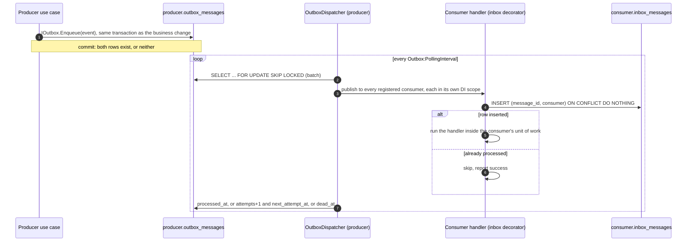

# Messaging

> Applies to: Acme.Service template

Modules exchange facts as integration events through a transactional outbox in the producer's schema and an inbox in each consumer's schema. Delivery is in-process and at-least-once; consumers are idempotent. See [ADR-0004](../adr/0004-transactional-outbox-and-inbox.md).

The code lives in `src/BuildingBlocks/Acme.Service.BuildingBlocks.Persistence/Outbox/`, `src/BuildingBlocks/Acme.Service.BuildingBlocks.Persistence/Inbox/` and `src/BuildingBlocks/Acme.Service.BuildingBlocks.Persistence/Messaging/`; the ports are in `src/BuildingBlocks/Acme.Service.BuildingBlocks/Messaging/`.

## Flow

## Publishing

- An integration event is a `sealed record` implementing `IIntegrationEvent` (`Id` as Guid v7, `OccurredAt`) with a stable name: `[IntegrationEvent("<module>.<kebab-name>.v<n>")]`. The persisted type is that name, never the CLR type name (INV-19). Public events live in the producer's Contracts under `IntegrationEvents/`; module-internal events (for example Auth's email-verification request) stay internal and are registered with `AddIntegrationEventTypes`.
- A use case calls the module's keyed `IOutbox.Enqueue(event)`. The row is saved by the same `SaveChanges` inside the transaction opened by `TransactionBehavior`, so the event exists if and only if the business change committed (INV-08). Use cases never publish to the bus or a queue directly.
- The outbox row id is the event `Id`. The row also records the correlation id and `traceparent` of the request, so the consumer's logs and spans join the original trace.

## Dispatching

One `OutboxDispatcher<TContext>` background service runs per module and replica:

1. Opens a transaction and selects up to `Outbox:BatchSize` due rows (`processed_at` and `dead_at` null, `next_attempt_at` reached), ordered by id, with `FOR UPDATE SKIP LOCKED`, so replicas never take the same row.
2. For each row, in its own try/catch so a poison message never blocks the batch: resolves the type from the event type registry, deserializes, and publishes through the in-process `IEventBus` to every consumer registered for that event.
3. Success sets `processed_at`. A failure increments `attempts` and sets `next_attempt_at = now + 2^attempts seconds`, capped at 5 minutes. At `Outbox:MaxAttempts` the row gets `dead_at`, an Error log and an `outbox.dead` metric increment.
4. An unknown type name or an unreadable payload is dead immediately. `last_error` stores the exception message, never the payload (INV-28).
5. Commits, then waits `Outbox:PollingInterval` when the batch was not full.

If the database is unreachable or the schema is missing (before `migrate`), the dispatcher backs off and logs a Warning at most once per minute.

Defaults: `Outbox:PollingInterval=00:00:02`, `Outbox:BatchSize=50`, `Outbox:MaxAttempts=10`, `Outbox:RetentionDays=7`, `Inbox:RetentionDays=30`. They are code defaults; set the keys only to override them.

## Consuming

Register a consumer with `AddIntegrationEventHandler<TEvent,THandler>(moduleKey, consumerName)` from `src/BuildingBlocks/Acme.Service.BuildingBlocks.Persistence/Messaging/MessagingServiceCollectionExtensions.cs`. This is the only way a handler is invoked: a raw `IIntegrationEventHandler<T>` registration is ignored, so the inbox cannot be bypassed (INV-09).

`InboxHandlerDecorator` runs the handler inside the consumer module's unit of work and first inserts `(message_id, consumer)` into the consumer's `inbox_messages` with `ON CONFLICT DO NOTHING`. Zero rows inserted means the message was already processed: the handler is skipped and the delivery counts as a success. The inbox row and the handler's writes commit together, so a crash between handler commit and `processed_at` leads to a redelivery that is deduplicated.

Pass an explicit, stable consumer name. The default (`<moduleKey>.<HandlerClassName>`) changes when the class is renamed, which would make old messages look new to the inbox.

When an event has several consumers, all of them run; if one fails the message is retried, and the consumers that already succeeded are skipped by their own inbox rows.

### Rules for handlers

- Be idempotent beyond the inbox too: delivery order is not guaranteed, so compare timestamps or versions before overwriting.
- No external I/O inside the handler's transaction (INV-10). To send email, call an HTTP API or write a blob, enqueue a job (`IJobQueue`) with ids only in the payload, and let the job do the I/O.
- Jobs are at-least-once too: a job that sends email can, rarely, send it twice.

## Dead letters and retention

A dead message stays in `outbox_messages` with `dead_at` set until someone acts on it. Watch the `outbox.dead` counter and the Error log line that names the message id, event type and module. After fixing the cause, a message can be replayed by clearing `dead_at`, resetting `attempts` and setting `next_attempt_at` to now with SQL against the producer's schema; the inbox makes the replay safe for consumers that already processed it.

`OutboxCleanupScheduler` registers the recurring `outbox-cleanup` job through `IJobQueue` at startup. The job takes a zero-wait distributed lock and deletes processed outbox rows older than `Outbox:RetentionDays` and inbox rows older than `Inbox:RetentionDays` in every module. Dead rows are never deleted automatically. Keep the inbox retention well above the longest possible redelivery window.

## Events in the template

| Event name | Producer | Consumers |
| --- | --- | --- |
| `auth.user-registered.v1` (`UserRegisteredV1`, public) | Auth, on registration and external provisioning | Any module that keeps a user snapshot |
| `auth.email-verification-requested.v1` (internal) | Auth | Auth: enqueues the verification email job |
| `auth.password-reset-requested.v1` (internal) | Auth | Auth: enqueues the password-reset email job |

<!-- <sample:orders> -->

| Event name | Producer | Consumers |
| --- | --- | --- |
| `orders.order-placed.v1` (`OrderPlacedV1`) | Orders, on order creation | Orders `OrderPlacedHandler`: enqueues `SendOrderPlacedNotificationJob` |
| `auth.user-registered.v1` | Auth | Orders `UserRegisteredHandler`: upserts `orders.customer_snapshots` |

<!-- </sample:orders> -->

## Related decisions

- [ADR-0004 Transactional outbox and inbox](../adr/0004-transactional-outbox-and-inbox.md)
- [ADR-0010 Hangfire with PostgreSQL storage](../adr/0010-hangfire-with-postgres-storage.md)
