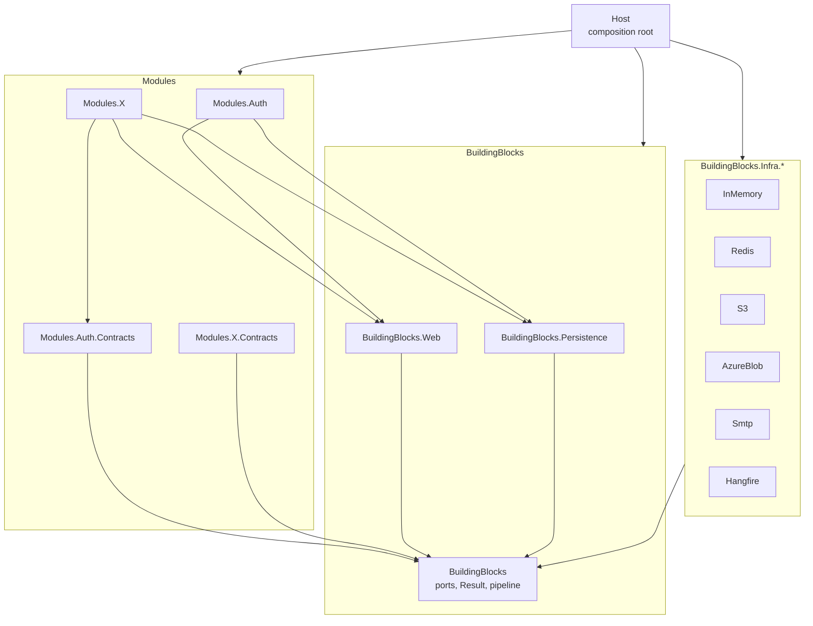

# Architecture overview

> Applies to: Acme.Service template

Acme.Service is a modular monolith: one process and one container image, internally split into modules that could be extracted later because they already behave like separate services. Each module owns its data, publishes facts as integration events, and exposes a small `*.Contracts` assembly for synchronous calls. See [ADR-0001](../adr/0001-modular-monolith.md).

## Building blocks

| Project | Role |
| --- | --- |
| `src/BuildingBlocks/Acme.Service.BuildingBlocks/` | Provider-neutral ports (`ICache`, `IBlobStore`, `INotificationSender`, `IJobQueue`, `IDistributedLock`, `IRepository`, `IUnitOfWork`, `IOutbox`), `Result`/`Error`, the use-case pipeline, paging and permission definitions. No infrastructure packages. |
| `src/BuildingBlocks/Acme.Service.BuildingBlocks.Web/` | `IModule` and `IEndpoint` discovery, `Result` to HTTP mapping, ProblemDetails, correlation ids, `perm:<name>` policies, the idempotency filter and list-query binding. |
| `src/BuildingBlocks/Acme.Service.BuildingBlocks.Persistence/` | `ModuleDbContext`, `EfRepository`, `EfUnitOfWork`, the outbox and inbox, the in-process event bus, the PostgreSQL advisory lock, the migration runner and the readiness checks. |
| `src/BuildingBlocks/Infra/` | One project per provider, each exposing an `IProviderRegistration` ([ADR-0008](../adr/0008-provider-model.md)). |
| `src/Modules/Auth/` | Identity, tokens, sessions, MFA, RBAC administration and the optional OIDC login ([ADR-0005](../adr/0005-auth-module-uses-identity-and-ef.md)). |
| `src/Host/Acme.Service.Host/` | The only project that references every other one. Builds the web app or a minimal command host. |

<!-- <sample:orders> -->

The sample module `src/Modules/Orders/` (with `src/Modules/Orders/Acme.Service.Modules.Orders.Contracts/`) shows the standard non-Auth module: ports-only use cases, EF Core confined to its `Persistence` namespace, an outbox event, two inbox consumers, jobs, blob attachments and idempotent creation.

<!-- </sample:orders> -->

## One binary, two verbs and a default web mode

`src/Host/Acme.Service.Host/Program.cs` dispatches on the first argument:

| Invocation | What runs |
| --- | --- |
| no verb | The web app. It never applies migrations, the Hangfire schema or seed data ([ADR-0009](../adr/0009-migrations-as-a-separate-job.md)). |
| `migrate` | A minimal host (`src/Host/Acme.Service.Host/Commands/MigrateCommand.cs`) that applies every module's EF migrations in registration order under one advisory lock, then runs the post-migration steps: the Hangfire schema (when `Jobs:Provider=Hangfire`) and the Auth permission and role seeder. `migrate --list` prints pending migrations. |
| `auth:grant-role --email <e> --role <r>` | A minimal host (`src/Host/Acme.Service.Host/Commands/GrantRoleVerb.cs`) that grants a role; the way to bootstrap the first Admin. |

The module list lives in one place, `src/Host/Acme.Service.Host/Modules/HostModules.cs`, so the web app and both command hosts see the same modules and contexts.

## Startup of the web app

1. Observability (Serilog and OpenTelemetry), forwarded headers, correlation ids, ProblemDetails, health checks, OpenAPI and Data Protection are registered.
2. `AddProviders` selects one provider per category from `<Category>:Provider` (`Cache`, `Blob`, `Notifications`, `Jobs`, `Locks`). A missing, unknown or duplicate name, or a development-only provider in `Production`, stops startup with the key named (INV-17).
3. `AddIdempotency` registers the `Idempotency-Key` filter.
4. `AddModules(HostModules.Create())` registers, per module, its use cases and validators, its persistence (`IModule.AddPersistence`) and its services (`IModule.AddServices`). The Auth module adds JWT bearer authentication, the fallback policy and the rate limiter policies.
5. Options are validated on start; any failure exits with code 1 and the failing keys logged.
6. The middleware pipeline is built in the order described in [request lifecycle](request-lifecycle.md).

## Where to go next

- [Module boundaries](module-boundaries.md) for the reference rules.
- [Data ownership](data-ownership.md) and [messaging](messaging.md) for cross-module data.
- [Security model](security-model.md) for authentication and authorization.
- [Failure modes](failure-modes.md) for behaviour under faults.
