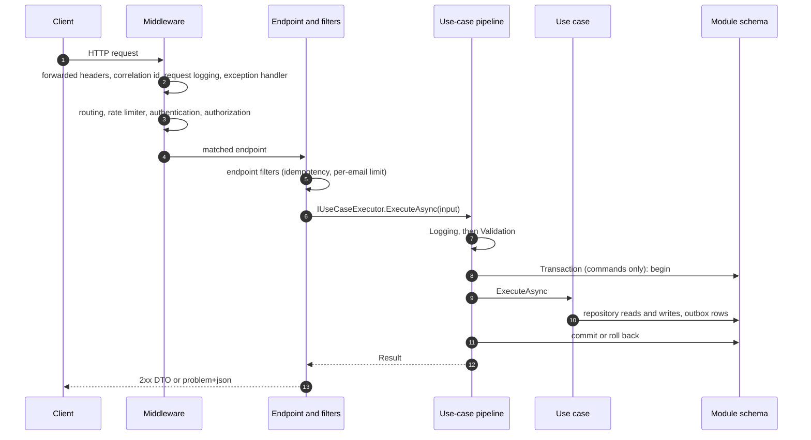
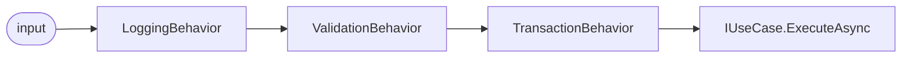

# Request lifecycle

> Applies to: Acme.Service template

This document follows one HTTP request through the web app. The middleware order is the one built in `RunWebAsync` in `src/Host/Acme.Service.Host/Program.cs`; the use-case pipeline is `src/BuildingBlocks/Acme.Service.BuildingBlocks/UseCases/UseCasePipeline.cs` with the behaviours in `src/BuildingBlocks/Acme.Service.BuildingBlocks/UseCases/Behaviors/`.

## Overview

## Middleware, in order

| # | Call in `Program.cs` | What it does | Why it sits here |
| --- | --- | --- | --- |
| 1 | `app.UseForwardedHeadersSetup()` | Applies `X-Forwarded-For` and `X-Forwarded-Proto` from the trusted networks and proxies in `Http:ForwardedHeaders` (`src/Host/Acme.Service.Host/Http/ForwardedHeadersSetup.cs`). | First, so every later component (logging, rate limiting, OIDC redirects) sees the real client address and scheme. |
| 2 | `app.UseCorrelationId()` | Accepts one valid `X-Correlation-Id` (1 to 64 characters of `[A-Za-z0-9-_]`) or generates one, echoes it on the response and opens a log scope (`src/BuildingBlocks/Acme.Service.BuildingBlocks.Web/Correlation/CorrelationIdMiddleware.cs`). | Before logging and error handling so both can include the id. |
| 3 | `app.UseRequestLogging()` | One Serilog summary event per request: method, path without query string, status, duration, correlation id. No headers (`src/Host/Acme.Service.Host/Observability/ObservabilityExtensions.cs`). | Wraps everything after it, including the error handler, so it logs the final status. |
| 4 | `app.UseProblemDetailsSetup()` | `UseExceptionHandler()` then `UseStatusCodePages()`, both rendering RFC 7807 ProblemDetails with `code`, `traceId` and `correlationId` (`src/BuildingBlocks/Acme.Service.BuildingBlocks.Web/Errors/ProblemDetailsSetup.cs`). | Catches exceptions and empty error responses from everything below it. |
| 5 | `app.UseRouting()` | Selects the endpoint. | Rate limiting and authorization need the endpoint's metadata. |
| 6 | `app.UseRateLimiter()` | Applies the endpoint's limiter policy (`auth-credentials`, `auth-email`), partitioned by client IP; rejections are 429 with `Retry-After` (`src/Modules/Auth/Acme.Service.Modules.Auth/RateLimiting/AuthRateLimitingSetup.cs`). | After forwarded headers (real IP) and routing (policy), before authentication so floods are cheap to reject. |
| 7 | `app.UseAuthentication()` | JWT bearer, validated statelessly against the local key ring ([security model](security-model.md)). | Before authorization. |
| 8 | `app.UseAuthorization()` | Endpoint policies (`perm:<name>`, `live-session`) and the fallback policy that requires an authenticated user everywhere else, including unmatched routes. | Last gate before the endpoint runs. |
| 9 | `MapHealthEndpoints`, `MapOpenApiSetup`, `MapModuleEndpoints`, `MapHangfireDashboardIfEnabled` | Endpoint registration: `/health/live` and `/health/ready` (anonymous), `/openapi/v1.json` and `/scalar` only when `OpenApi:Enabled=true`, every module `IEndpoint`, and `/hangfire` only in Development with the dashboard enabled. | Endpoints execute at the end of the pipeline. |

Outbound calls made with an `HttpClient` from `IHttpClientFactory` carry the correlation id through `src/BuildingBlocks/Acme.Service.BuildingBlocks.Web/Correlation/CorrelationIdDelegatingHandler.cs`, and the W3C `traceparent` is propagated by OpenTelemetry.

## Endpoint

Each feature has an `IEndpoint` that maps a route and declares its authorization. A typical command endpoint:

1. binds the body and route values (binding failures are 400 ProblemDetails);
2. reads the caller's id from the token claims;
3. builds the command or query record and calls `IUseCaseExecutor<TIn,TOut>.ExecuteAsync(input, context.RequestAborted)`;
4. converts the `Result` with `ToHttpResult()` (`src/BuildingBlocks/Acme.Service.BuildingBlocks.Web/Results/ResultHttpExtensions.cs`): 200 with the DTO, 201 with `Location`, 204, or the problem response for the error type.

Endpoint filters run around the handler:

- **Idempotency** (`.WithIdempotency()`, `src/BuildingBlocks/Acme.Service.BuildingBlocks.Web/Idempotency/IdempotencyFilter.cs`). With an `Idempotency-Key` header, the filter takes an atomic in-progress marker in the cache, replays a completed response for the same key and body (`Idempotent-Replayed: true`), returns 409 `idempotency_in_progress` while the first request runs, 422 `idempotency_key_reused` for a different body, and 503 `idempotency_unavailable` when the cache is down and `Idempotency:FailMode=Closed`.
- **Per-email rate limit** on the `auth-email` endpoints, which reads the normalized email from the buffered body (at most 4 KB) because limiter partitioners cannot read bodies.

## Use-case pipeline

`AddUseCasesFromAssembly` registers the open-generic `UseCasePipeline<TIn,TOut>` as `IUseCaseExecutor<TIn,TOut>` and three behaviours, outermost first ([ADR-0002](../adr/0002-hand-rolled-use-case-pipeline.md)):

| Behaviour | Behaviour for `ICommand<TOut>` | Behaviour for `IQuery<TOut>` and other inputs |
| --- | --- | --- |
| `LoggingBehavior` | Logs the use-case name, outcome, error code and duration. Never logs the input (INV-28). | Same. |
| `ValidationBehavior` | Runs every FluentValidation validator asynchronously. Any failure returns `validation_failed` (400) with per-property details; the use case is not called. | Same. |
| `TransactionBehavior` | Resolves the owning module's keyed `IUnitOfWork` from the input's assembly and runs the rest inside one transaction: success commits (including outbox rows), failure or exception rolls back. Retries transient faults only when the input implements `IRetryableCommand`; otherwise a transient fault is 503 `database_unavailable` with `Retry-After`. | Passes straight through. Repository reads outside a transaction run under the retrying execution strategy. |

Exceptions are never turned into results by the pipeline; they propagate to the exception handler (500 `internal_error`, no details outside Development).

The same executor is used by non-HTTP callers such as jobs and integration event handlers, so validation and transactions apply to them too.

### Deliberate exceptions

Some inputs are plain records rather than `ICommand` because a failure must still commit a write, or because the work must not run inside a transaction:

- Auth `Login`, `Refresh`, `LoginMfa`, `ChangePassword`, `MfaDisable`, `MfaRecoveryCodes` and `ExternalExchange`: failed-attempt counters, lockout, challenge attempts and refresh-token reuse revocation must persist even when the request fails. These use cases still run through the executor (logging and validation) but persist their own writes, through Identity or an explicit unit of work, instead of relying on `TransactionBehavior`.

<!-- <sample:orders> -->

- Orders `UploadAttachment` (`src/Modules/Orders/Acme.Service.Modules.Orders/Features/UploadAttachment/UploadAttachmentUseCase.cs`): the blob is written first, outside any transaction (INV-10), then the metadata row is saved in the module's unit of work; the blob is deleted if that save fails.

<!-- </sample:orders> -->

## Related decisions

- [ADR-0002 Hand-rolled use-case pipeline](../adr/0002-hand-rolled-use-case-pipeline.md)
- [ADR-0011 ProblemDetails, no envelope](../adr/0011-problem-details-no-envelope.md)
- [ADR-0012 In-process rate limiting](../adr/0012-in-process-rate-limiting.md)
